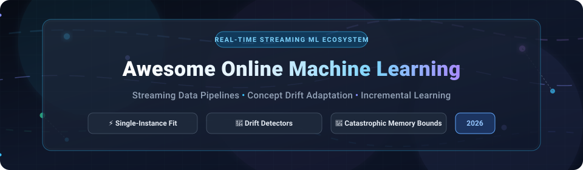

<div align="center">



# ⚡ Awesome Online Machine Learning 🌊

**A curated directory of SaaS platforms, real-time algorithms, streaming data engines, and open-source libraries for incremental learning and concept drift adaptation.**

<p align="center">
  <a href="https://github.com/ishandutta2007/Awesome-Awesome-Awesome"></a><a href="https://discord.gg/jc4xtF58Ve"></a>
  <a href="https://github.com/ishandutta2007/Awesome-Online-Machine-Learning/stargazers"></a>
  <a href="https://github.com/ishandutta2007/Awesome-Online-Machine-Learning/network/members"></a>
  <a href="https://github.com/ishandutta2007/Awesome-Online-Machine-Learning/blob/main/LICENSE"></a>
  <a href="https://github.com/ishandutta2007/Awesome-Online-Machine-Learning/pulls"></a>
  <a href="https://github.com/ishandutta2007"></a>
</p>

*Last updated: March 2026*

</div>

---

## 📌 Executive Summary & SEO Overview

**Online Machine Learning** (also referred to as *streaming machine learning*, *incremental learning*, or *continual stream mining*) processes and fits models sequentially on streaming data — updating model parameters **one observation or mini-batch at a time**. 

Unlike conventional batch retraining that recomputes estimators across historical terabytes in high-memory offline clusters, online learning algorithms:
- 🔄 **Adapt dynamically to concept drift** (sudden, gradual, incremental, or recurring shifts in underlying data distributions).
- 🧠 **Maintain bounded memory complexity** $\mathcal{O}(1)$ or $\mathcal{O}(w)$ with sliding windows.
- ⚡ **Eliminate batch retraining latency** to deliver real-time inference updates in high-throughput production environments (financial fraud detection, ad click-through prediction, algorithmic trading, network intrusion detection, and IoT edge analytics).

---

## 📑 Table of Contents

- [🌐 Sector Overview & Market Dynamics](#-sector-overview--market-dynamics)
- [🏢 SaaS & Hosted Platforms](#-saas--hosted-platforms)
- [💻 Open-Source Projects (Sorted by Stars)](#-open-source-projects-sorted-by-stars)
- [🔬 Core Architectural Concepts: Online vs. Batch ML](#-core-architectural-concepts-online-vs-batch-ml)
- [🤝 How to Contribute](#-how-to-contribute)
- [⭐ Star History](#-star-history)
- [💖 Support & Sponsorship](#-support--sponsorship)
- [⚖️ Disclaimer](#️-disclaimer)

---

## 🌐 Sector Overview & Market Dynamics

The global **streaming analytics and real-time machine learning sector** is valued between **$43.19 billion and $57.08 billion in 2026**, expanding at an aggressive Compound Annual Growth Rate (**CAGR**) of **26.0% to 32.4%** toward exceeding **$150+ billion by the early 2030s**, catalyzed by event-driven architectures (Apache Kafka, Apache Pulsar, Apache Flink), IoT telemetry feeds, and low-latency fraud-prevention demands.

The market structure is **moderately to highly fragmented** rather than winner-take-all:
- **Specialized Open-Source Algorithms & Frameworks** (such as River, Vowpal Wabbit, Flink ML, and Avalanche) dominate developer-led, ultra-low-latency, edge, and out-of-core algorithmic workflows.
- **Enterprise SaaS & MLOps Suites** (such as Altair RapidMiner, DataRobot, Alteryx, and H2O.ai) capture governed automated pipelines, time-series forecasting, and scheduled retraining for business analysts.
- Because diverse production constraints (in-memory microsecond scoring vs. distributed streaming clusters vs. regulatory compliance) resist standardization under a single proprietary stack, no single vendor maintains a monopoly, fostering healthy coexistence between specialized stream-mining libraries and hybrid cloud ecosystems.

---

## 🏢 SaaS & Hosted Platforms

The table below compiles leading hosted and enterprise SaaS platforms offering online learning, streaming scoring, automated drift retraining, and real-time pipeline integration, **sorted in descending order by company valuation / scale**:

| 🏢 Platform / SaaS | 🏷️ Focus & Capabilities | 💰 Starting Pricing | 🎁 Free Tier / Trial Limits | 📊 Company Size (Valuation / Revenue) | 🔗 Link |
| :--- | :--- | :--- | :--- | :--- | :--- |
| **Altair RapidMiner** | Streaming AutoML & Flink-based online machine learning via **Athena OML** operator for real-time Kafka event streams | **$2,500 / user / year** (AI Studio Professional; Enterprise deployment from $10,000/yr) | **Free Community Edition**: Permanent $0 tier capped at 10,000 data rows/process and 1 logical processor (30-day enterprise trial via sales) | **~$10.6B Valuation** (Parent Altair acquired by Siemens; RapidMiner acquired for $100M) | [Visit Platform](https://altair.com/rapidminer) |
| **DataRobot** | Enterprise AutoML with automated model selection, time-series forecasting, and streaming scoring engine | **~$65,000 / year** (Base enterprise annual subscription; AWS Marketplace hourly options available) | **30-Day Free Trial**: Full SaaS evaluation capped at 1,000 generative/LLM calls, 15 vector DBs, and shared modeling workers (no credit card required) | **~$6.3B Valuation** (Peak Series G valuation; ~$200M+ ARR) | [Visit Platform](https://www.datarobot.com/) |
| **Alteryx** *(Designer Cloud)* | Browser-based data preparation, scheduled predictive pipeline retraining, and streaming ingestion connectors | **$3,000 / user / year** ($250/mo billed annually for Starter Edition; Designer Desktop list $5,195/user/yr) | **30-Day Free Trial**: Unrestricted cloud canvas evaluation with drag-and-drop workflow builder (Starter tier restricted to 1–10 seats) | **~$4.4B Valuation** (Acquired by Clearlake Capital & Insight Partners; ~$900M+ annual revenue) | [Visit Platform](https://www.alteryx.com/) |
| **H2O.ai** *(Driverless AI)* | Automated machine learning engine featuring incremental model updating, time-series drift tracking, and real-time low-latency scoring MOJOs | **$25,000 / license / year** (H2O Driverless AI single-node production starting tier; Cloud bundles scale higher) | **90-Day Free Trial** on H2O AI Cloud (or 21-day evaluation license key for on-premises/cloud Driverless AI; 2-hour interactive Aquarium test drive) | **~$1.7B Valuation** (Series E round led by Commonwealth Bank of Australia; ~$60M+ ARR) | [Visit Platform](https://h2o.ai/) |
| **KNIME** *(Business & Community Hub)* | Visual workflow data science platform with continuous streaming connectors, Kafka/Spark integrations, and automated pipeline execution | **$19 / month** ($228/yr) for Community Hub Pro; **$99 / month** for Community Hub Team (3 users); Desktop is $0 | **100% Free Forever**: KNIME Analytics Platform (unlimited local rows & execution); Community Hub free tier includes 1 GB cloud storage and 20 K-AI assistant interactions/month | **~$250M – $300M Valuation** (Privately held venture-backed; ~$50M ARR) | [Visit Platform](https://www.knime.com/) |
| **BigML** | Machine Learning-as-a-Service (MLaaS) providing REST APIs for instant online predictions, streaming anomaly detection, and incremental association mining | **$30 / month** (Pro personal/developer plan; Enterprise virtual private cloud packages from $1,000/mo) | **Free Development Account**: Permanent free mode restricted to 16 MB max dataset size and 2 concurrent parallel tasks (plus 3-day full evaluation trial) | **~$50M Valuation** (~$10.6M annual revenue) | [Visit Platform](https://bigml.com/) |

---

## 💻 Open-Source Projects (Sorted by Stars)

This section documents the premier open-source repositories for incremental learning, concept drift detection, streaming feature extraction, and continual learning. **Each project includes a live GitHub Stars_Badge linking to its stargazers page, sorted strictly in descending order by GitHub Stars_Count:**

### 1. [scikit-learn](https://github.com/scikit-learn/scikit-learn) [](https://github.com/scikit-learn/scikit-learn/stargazers)
- **License**: BSD-3-Clause
- **Category**: Incremental & Out-of-Core Batch Learning
- **Overview**: Python's cornerstone machine learning package delivers an incremental learning interface via the `partial_fit` API. This allows models to stream mini-batches when datasets exceed available physical RAM.
- **Key Algorithms**:
  - *Classification*: `SGDClassifier`, `Perceptron`, `MultinomialNB`, `PassiveAggressiveClassifier`, `MLPClassifier`.
  - *Regression*: `SGDRegressor`, `PassiveAggressiveRegressor`, `MLPRegressor`.
  - *Clustering & Preprocessing*: `MiniBatchKMeans`, `Birch`, `StandardScaler`, `IncrementalPCA`.
- **Engineering Nuance**: Classification `partial_fit` requires passing the full set of universe classes (`classes=np.array([...])`) on every call. If an unseen label appears mid-stream without explicit prior registration, scikit-learn raises a `ValueError`. Use stateless tokenizers like `HashingVectorizer` to prevent expanding memory footprints.

### 2. [Apache Spark](https://github.com/apache/spark) [](https://github.com/apache/spark/stargazers)
- **License**: Apache-2.0
- **Category**: Distributed Streaming Big Data & MLlib
- **Overview**: Spark Structured Streaming treats continuous data streams as append-only unbounded tables, supporting scalable batch-to-streaming model scoring (`model.transform(streaming_df)`).
- **Key Capabilities**: Spark MLlib Pipeline API seamlessly unifies feature transformers (e.g., tokenizers, string indexers, vector assemblers) with pre-trained models.
- **Architectural Trade-offs**: Spark Structured Streaming excels at applying pre-trained models to distributed high-throughput event logs (Kafka, Delta Lake); native per-record continuous online retraining requires integration with external coordination systems.

### 3. [Apache Flink](https://github.com/apache/flink) [](https://github.com/apache/flink/stargazers)
- **License**: Apache-2.0
- **Category**: Distributed State-Driven Stream Processing & Iteration Engine
- **Overview**: Flink provides true sub-millisecond, record-at-a-time event stream processing with stateful checkpointing and exactly-once processing guarantees.
- **Key Capabilities**: Serves as the high-throughput operational backbone for continuous streaming ML loops (consuming event topics, managing stateful sliding windows, emitting model updates to low-latency inference stores).

### 4. [sktime](https://github.com/sktime/sktime) [](https://github.com/sktime/sktime/stargazers)
- **License**: BSD-3-Clause
- **Category**: Streaming Time Series & Online Forecasting
- **Overview**: A unified Python framework for time series analysis providing dedicated interfaces for online/streaming forecasting, recursive model updates, and stream-based anomaly detection.
- **Key Capabilities**: Wraps streaming forecasters that update internal coefficients on every incoming time tick without refitting historical series; includes sliding-window drift detectors for changing temporal seasonality.

### 5. [Vowpal Wabbit](https://github.com/VowpalWabbit/vowpal_wabbit) [](https://github.com/VowpalWabbit/vowpal_wabbit/stargazers)
- **License**: BSD-3-Clause
- **Category**: High-Performance Out-of-Core & Interactive Learning
- **Overview**: Originating at Yahoo! Research and accelerated by Microsoft Research, Vowpal Wabbit is an industrial C++ machine learning engine designed for extreme scale, multi-gigabit throughput, and ultra-sparse feature spaces.
- **Key Capabilities**:
  - Out-of-core online gradient descent, the **hashing trick** (feature hashing into bit-bounded spaces), and multi-threaded SIMD reductions.
  - World-class contextual bandits, active learning, and reinforcement learning reductions (`explore-eval`, `cb_adf`).
  - Seamless Python wrapper (`VWClassifier`, `VWRegressor`) compatible with scikit-learn estimators.

### 6. [Evidently](https://github.com/evidentlyai/evidently) [](https://github.com/evidentlyai/evidently/stargazers)
- **License**: Apache-2.0
- **Category**: Real-Time ML Observability & Concept Drift Detection
- **Overview**: Open-source evaluation and monitoring platform for production ML architectures. Evaluates data drift, target drift, covariate shifts, and model decay on streaming inputs.
- **Key Capabilities**: Generates interactive HTML visual reports, streaming telemetry metrics, and automated alerts when live feature distributions diverge significantly from baseline reference datasets.

### 7. [Numenta NuPIC](https://github.com/numenta/nupic) [](https://github.com/numenta/nupic/stargazers)
- **License**: AGPL-3.0
- **Category**: Hierarchical Temporal Memory (HTM) & Biologically-Inspired Online Learning
- **Overview**: Implements Hierarchical Temporal Memory (HTM) cortical learning algorithms in C++ and Python. Models learn continuously from streaming spatial-temporal patterns one sample at a time.
- **Key Capabilities**: Unsupervised real-time anomaly detection, online temporal prediction, and automatic continuous adaptation without distinct offline training phases.

### 8. [River](https://github.com/online-ml/river) [](https://github.com/online-ml/river/stargazers)
- **License**: BSD-3-Clause
- **Category**: Pure Online Machine Learning for Python
- **Overview**: The gold standard for pure streaming machine learning in Python, forged from the union of `creme` and `scikit-multiflow`. River processes data **one single observation at a time** using native Python dictionaries.
- **Key Capabilities**:
  - Streaming classifiers and regressors (Hoeffding Trees, Adaptive Random Forests, Logistic Regression with SGD).
  - Online drift detectors: ADWIN (Adaptive Windowing), DDM, EDDM, Page-Hinkley.
  - Streaming anomaly detection (Half-Space Trees), online clustering, and rolling metrics calculated on unbounded streams.
  - High speed in streaming contexts because dictionary inputs bypass the dense array conversion overhead and fixed feature constraints of traditional batch libraries.

### 9. [whylogs](https://github.com/whylabs/whylogs) [](https://github.com/whylabs/whylogs/stargazers)
- **License**: Apache-2.0
- **Category**: Statistical Profiling & Streaming Data Drift Logging
- **Overview**: The open standard for data logging and statistical profiling. Enables deterministic, zero-dependency statistical summaries of continuous high-volume streaming data with mergeable sketch algorithms.
- **Key Capabilities**: Operates in sub-millisecond execution times with bounded memory; tracks null rates, quantile drift, cardinality, and schema mutations without storing raw rows.

### 10. [Alibi Detect](https://github.com/SeldonIO/alibi-detect) [](https://github.com/SeldonIO/alibi-detect/stargazers)
- **License**: Apache-2.0
- **Category**: Outlier, Adversarial & Drift Detection
- **Overview**: Developed by Seldon, Alibi Detect focuses on detecting anomalies and distribution shifts for tabular data, natural language, and computer vision models.
- **Key Capabilities**: Online detectors with sequential testing (CUSUM, Page-Hinkley), Maximum Mean Discrepancy (MMD), Kolmogorov-Smirnov, and Learned Kernel drift detection on streaming payloads.

### 11. [Avalanche](https://github.com/ContinualAI/avalanche) [](https://github.com/ContinualAI/avalanche/stargazers)
- **License**: MIT
- **Category**: PyTorch-Based Continual & Lifelong Learning
- **Overview**: Developed by the ContinualAI community, Avalanche is an end-to-end continual learning framework designed to solve **catastrophic forgetting** during sequential and online deep learning.
- **Key Capabilities**:
  - Continual learning strategies: Replay buffers, EWC (Elastic Weight Consolidation), GEM, Synaptic Intelligence, and Learning without Forgetting (LwF).
  - Standard continual learning benchmarks (Split-MNIST, Permuted-MNIST, Core50) with customizable streaming evaluation metrics.

### 12. [Streamz](https://github.com/python-streamz/streamz) [](https://github.com/python-streamz/streamz/stargazers)
- **License**: BSD-3-Clause
- **Category**: Event-Driven Streaming Data Pipelines
- **Overview**: A lightweight Python library for assembling real-time streaming pipelines. Streamz manages continuous streams of data, combining branching, buffering, windowing, and streaming ML inference.
- **Key Capabilities**: Seamlessly integrates with Dask, Kafka, Tornado, and Pandas to route event records through incremental transformation pipelines and online scoring models.

### 13. [Dask-ML](https://github.com/dask/dask-ml) [](https://github.com/dask/dask-ml/stargazers)
- **License**: BSD-3-Clause
- **Category**: Scalable Out-of-Core Machine Learning
- **Overview**: Provides distributed and out-of-core machine learning algorithms that scale NumPy and Pandas across parallel clusters via Dask.
- **Key Capabilities**: Implements `Incremental` meta-estimators that wrap scikit-learn estimators supporting `partial_fit`, orchestrating out-of-core mini-batch updates across multi-gigabyte or terabyte disk partitions.

### 14. [scikit-multiflow](https://github.com/scikit-multiflow/scikit-multiflow) [](https://github.com/scikit-multiflow/scikit-multiflow/stargazers)
- **License**: BSD-3-Clause
- **Category**: Multi-Output Stream Mining *(Historical / Merged into River)*
- **Overview**: Created by Telecom ParisTech and Montanuniversitat Leoben for streaming data mining, concept drift detection, and multi-output learning.
- **Significance**: Provided foundational streaming tree algorithms (Hoeffding Tree, HAT) that were subsequently merged with `creme` to build the unified `River` ecosystem.

### 15. [MOA (Massive Online Analysis)](https://github.com/Waikato/moa) [](https://github.com/Waikato/moa/stargazers)
- **License**: GNU GPLv3
- **Category**: Academic Stream Mining Engine (Java)
- **Overview**: Originating from the University of Waikato (home of WEKA), MOA is the classic academic open-source framework for massive data stream mining.
- **Key Capabilities**: Comprehensive collection of streaming algorithms for classification, regression, clustering, outlier detection, and concept drift evaluation (prequential evaluation).

### 16. [Apache Flink ML](https://github.com/apache/flink-ml) [](https://github.com/apache/flink-ml/stargazers)
- **License**: Apache-2.0
- **Category**: Distributed Online Machine Learning Library
- **Overview**: The official machine learning library of the Apache Flink project, engineered for unified iteration and real-time streaming ML pipelines.
- **Key Capabilities**: Features native streaming algorithms (K-Means, Logistic Regression, Naive Bayes, KNN), Estimator/Transformer abstractions, and a Python SDK (`apache-flink-ml`). Business feedback loops train continuously on incremental Kafka records and version updates to serving layers without downtime.

### 17. [Frouros](https://github.com/IFCA-Advanced-Computing/frouros) [](https://github.com/IFCA-Advanced-Computing/frouros/stargazers)
- **License**: BSD-3-Clause
- **Category**: Python Concept Drift Detection Library
- **Overview**: Maintained by IFCA Advanced Computing, Frouros delivers a modular open-source library dedicated to detecting concept drift and data drift in machine learning workflows.
- **Key Capabilities**: Implements both streaming/online detectors (DDM, EDDM, Page-Hinkley, ADWIN, STEPD) and batch-oriented statistical tests (Cramer-von Mises, Kolmogorov-Smirnov, Earth Mover's Distance).

### 18. [River-Torch](https://github.com/online-ml/river-torch) [](https://github.com/online-ml/river-torch/stargazers)
- **License**: BSD-3-Clause
- **Category**: PyTorch Deep Learning Extension for River
- **Overview**: Developed by the River core maintainers to bridge PyTorch neural network modules into River's single-instance streaming pipelines.
- **Key Capabilities**: Wraps arbitrary `torch.nn.Module` architectures with PyTorch optimizers and loss functions, allowing deep learning practitioners to evaluate neural nets under true online data streaming conditions.

### 19. [LIBOL](https://github.com/LIBOL/LIBOL) [](https://github.com/LIBOL/LIBOL/stargazers)
- **License**: GNU GPLv3
- **Category**: Academic Online Learning Library (C++ / MATLAB)
- **Overview**: Library for Online Learning Algorithms, authored by Steven Hoi and collaborators. A historical reference implementing foundational linear online algorithms (Perceptron, Passive-Aggressive, Second-Order Perceptron, Confidence Weighted).

---

## 🔬 Core Architectural Concepts: Online vs. Batch ML

```
                      TRADITIONAL BATCH MACHINE LEARNING
    [ Historical Data ] ──> [ High-Memory Cluster ] ──> [ Static Model ] ──> [ Outdated Predictions ]
             ▲                                                    │ (Slow Retraining Cycle)
             └────────────────── Retrain Weeks Later ─────────────┘

                       STREAMING ONLINE MACHINE LEARNING
    [ Event Stream ] ──> [ 1-by-1 or Mini-Batch ] ──> [ Drift Detector ] ──> [ Live Adaptive Model ]
             │                       │                        │                      │
       (Kafka/Pulsar)       (Single Record Fit)         (ADWIN / DDM)        (Real-Time Scoring)
```

| Dimension | 🔄 Online / Streaming Machine Learning | 📦 Traditional Batch Machine Learning |
| :--- | :--- | :--- |
| **Observation Ingestion** | Instantaneous: one-by-one or micro-batches | Monolithic: millions of rows loaded at once |
| **Memory Complexity** | $\mathcal{O}(1)$ or bounded sliding window $\mathcal{O}(w)$ | $\mathcal{O}(N)$ where $N$ scales with historical dataset size |
| **Concept Drift Handling** | Adaptive: continuous weight updates & drift triggers | Reactive: scheduled weekly or monthly retraining runs |
| **Evaluation Method** | Prequential / Test-Then-Train evaluation | Held-out static test set or k-fold cross-validation |
| **Infrastructure** | Event brokers (Kafka, Flink, River, VW) | Data warehouses (Snowflake, Spark, BigQuery) |
| **Primary Failure Mode** | Sensitivity to stream noise & adversarial shifts | Latency lag, high compute costs, stale models |

---

## 🤝 How to Contribute

We welcome additions, fixes, and ecosystem enhancements! To contribute:

1. 🍴 **Fork this repository** to your GitHub account.
2. 🌿 **Create a descriptive feature branch**: `git checkout -b add-my-tool`.
3. 📝 **Add your entry** to [README.md](README.md) following existing formatting conventions (ensure exact pricing and free tier limits are stated for SaaS; ensure verified Stars_Counts and social badge links are present for open-source).
4. 📬 **Submit a Pull Request** with a concise description of why the tool is valuable for online machine learning.

> ⭐ **Discover more awesome curated lists at [Awesome-Awesome-Awesome](https://github.com/ishandutta2007/Awesome-Awesome-Awesome)!**

---

## ⭐ Star History

[](https://star-history.dera.page/#ishandutta2007/Awesome-Online-Machine-Learning&type=date&legend=top-left)

---

## 💖 Support & Sponsorship

Thank you for visiting and supporting the **Awesome Online Machine Learning** project! 

If you find this repository helpful for your machine learning engineering workflows, research, or real-time architecture design, please consider:
- ⭐ **Starring this repository** to improve visibility for the online ML community.
- 🍴 **Forking and sharing** it with fellow data scientists and streaming engineers.
- ☕ **Buying a coffee or sponsoring ongoing open-source curation** via the **[GitHub Sponsors Dashboard](https://github.com/sponsors/ishandutta2007)**.

Your support helps keep this guide thoroughly researched, accurate, and continually updated! 🚀

---

## ⚖️ Disclaimer

- This is an **independently curated community guide** intended solely for educational, engineering, and comparative reference; mentions do not constitute commercial endorsement.
- Online machine learning systems present unique operational trade-offs compared to batch models. Ensure adequate stream infrastructure (Kafka/Flink/Spark), stateless preprocessing (hashing trick), and valid prequential evaluation architectures to prevent data leakage and performance degradation.
- Pricing, valuations, and free tier parameters reflect publicly accessible documentation as of **March 2026** and may vary over time according to individual vendor policies.

---

<div align="center">
  <b>Built with ❤️ for ML engineers, data scientists, and distributed streaming architects worldwide.</b>
</div>
